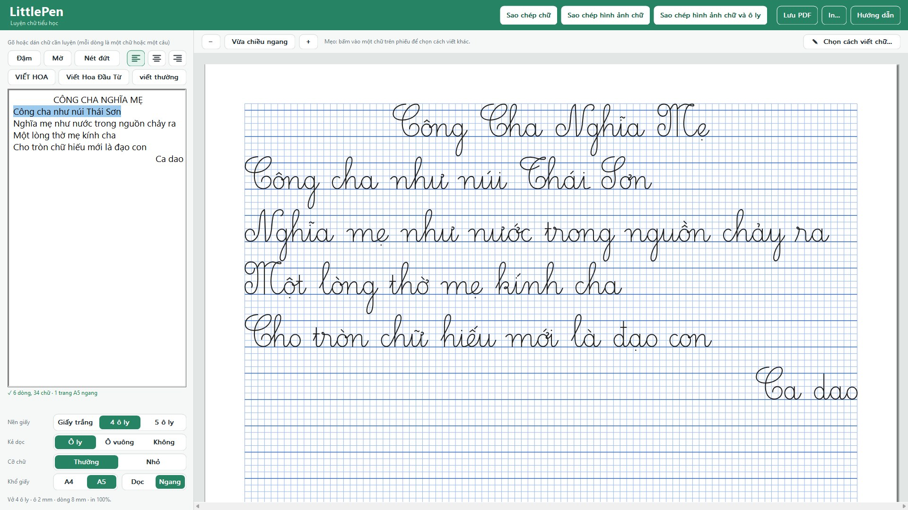

# LittlePen – Luyện chữ tiếng Việt cho học sinh tiểu học

  

**LittlePen** giúp thầy cô và phụ huynh soạn phiếu luyện viết chữ tiếng Việt ngay trên máy tính Windows. Gõ hoặc dán bất kỳ nội dung nào (danh sách từ, một câu hay một bài thơ ngắn), LittlePen trình bày thành chữ viết tay theo mẫu chữ trường học trên giấy ô ly giống vở tập viết của các con, rồi in hoặc lưu PDF.

👉 **Tải miễn phí từ Microsoft Store (link chính thức):** https://apps.microsoft.com/detail/9NJLD088J3T8

## Tính năng nổi bật

- **Định dạng chữ dễ như trong Word:** bôi đen chữ rồi bấm Đậm, Mờ (chữ xám) hoặc Nét đứt để học sinh tô theo; căn trái, giữa, phải từng dòng; đổi nhanh sang VIẾT HOA, Viết Hoa Đầu Từ hoặc viết thường.
- **Chọn cách viết từng chữ:** bấm vào một chữ trên phiếu để xem các kiểu nét nối và chọn cách thầy cô dạy. LittlePen nhớ lựa chọn cho lần sau.
- **Giấy giống vở của con:** vở 4 ô ly, 5 ô ly hoặc giấy trắng; kẻ dọc từng ô ly, kẻ ô vuông lớn hoặc không kẻ dọc. Ô ly 2 mm, đúng kích thước vở thật khi in 100%.
- **Khổ A4 hoặc A5**, giấy dọc hoặc ngang, tự chia trang.
- **Xem trước ngay khi gõ**, in trực tiếp hoặc lưu PDF để gửi phụ huynh.
- **Sao chép** chữ tập viết dưới dạng chữ, hình ảnh chữ hoặc hình ảnh chữ kèm ô ly để dán vào Word, PowerPoint.
- Mỗi lần mở có sẵn một bài ca dao, tục ngữ hoặc thơ ngắn ngẫu nhiên để luyện.
- Dùng được khi không có mạng, không cần tài khoản.

## Cài đặt

1. Mở link: https://apps.microsoft.com/detail/9NJLD088J3T8
2. Bấm **Tải xuống / Cài đặt** (Get / Install). Microsoft Store sẽ tự cài và tự cập nhật phiên bản mới.
3. Mở **LittlePen** từ menu Start.

> Đây là kênh phân phối chính thức duy nhất. Repo này không còn cung cấp file `.exe`; để an toàn, thầy cô vui lòng chỉ tải ứng dụng từ Microsoft Store.

## Tài liệu tham khảo miễn phí trong repo

Ngoài ứng dụng, repo vẫn giữ các tài liệu để thầy cô dùng thêm khi soạn bài:

| Thư mục / file | Nội dung |
| --- | --- |
| [Hướng dẫn chữ thường](Hướng%20dẫn%20chữ%20thường) | Ảnh hướng dẫn viết từng chữ thường |
| [Hướng dẫn chữ hoa](Hướng%20dẫn%20chữ%20hoa) | Ảnh hướng dẫn viết từng chữ hoa |
| [Hướng dẫn viết nét](Hướng%20dẫn%20viết%20nét) | Ảnh hướng dẫn các nét cơ bản |
| [Hướng dẫn viết số](Hướng%20dẫn%20viết%20số) | Ảnh hướng dẫn viết chữ số |
| [Ảnh dòng kẻ sẵn cho môn toán](Ảnh%20dòng%20kẻ%20sẵn%20cho%20môn%20toán) | Ảnh dòng kẻ ô ly nhiều kích cỡ |
| [Các phiếu luyện chữ mẫu Size A4](Các%20phiếu%20luyện%20chữ%20mẫu%20Size%20A4), [Size A5](Các%20phiếu%20luyện%20chữ%20mẫu%20Size%20A5) | Phiếu luyện chữ, luyện nét mẫu (Word) |
| `FIle luyện chữ mẫu 4/5 hàng nét 1 ô ly.docx` | File Word mẫu luyện chữ |

**Về font chữ:** repo không kèm font. Các file Word mẫu dùng font luyện chữ "HP001 4 hàng / 5 hàng"; nếu mở ra thấy chữ lằng nhằng nghĩa là máy chưa có font này, thầy cô vui lòng tự tìm và cài font trên mạng. Ứng dụng LittlePen đã có sẵn font chữ tập viết bên trong, không cần cài thêm.

## Góp ý

Mọi góp ý xin gửi về: langmaninternet@gmail.com hoặc qua Facebook: https://www.facebook.com/langmaninternet

Thầy cô cũng có thể đánh giá và nhận xét trực tiếp trên trang [Microsoft Store của LittlePen](https://apps.microsoft.com/detail/9NJLD088J3T8) để ứng dụng ngày càng tốt hơn.
